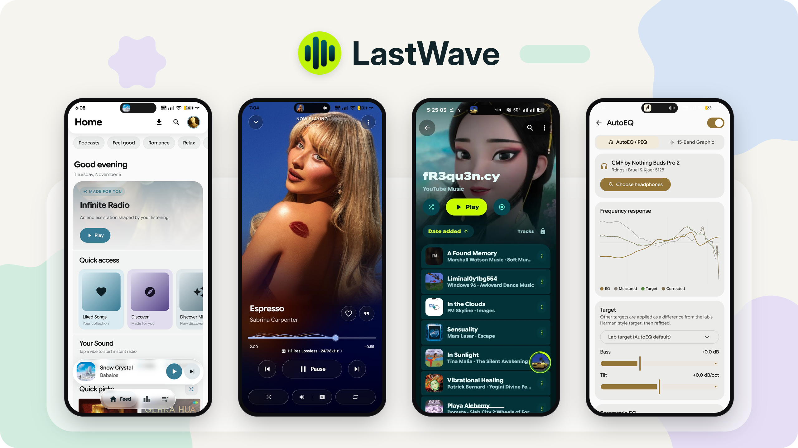

<h1>Echo Music</h1>

**Simple Android YouTube Music client with Material UI, Liquid Glass, Bit-Perfect playback, Automix, Lossless addons & advanced audiophile features.**

 

  
  &nbsp;
  
  &nbsp;
  

  
  
  
  

---

## 📖 Overview

**Echo Music** is a fast, native YouTube Music client for Android that looks great and sounds even better. Built with Material 3 Expressive and Liquid Glass UI, it gives you a clean, fluid design that adapts to your music.

For audio lovers, Echo Music packs Bit-Perfect USB DAC output, Lossless FLAC addon support, AutoEQ headphone presets with parametric EQ, smooth Automix transitions, Spotify Canvas & integration, and real-time synced lyrics, all in a lightweight app.

---

## ✨ Features

<table>
  <tr>
    <td width="50%" valign="top">

#### 🎵 Playback
- Stream any track or video from YouTube Music
- Background playback with lockscreen & Android Auto controls
- High-res audio downloads with embedded tags & `.lrc` lyrics
- Download & cache for offline listening
- Skip silence & sleep timer

</td>
<td width="50%" valign="top">

#### 🎧 Audio
- Bit-Perfect USB DAC output (direct hardware bypass)
- Lossless FLAC addon support (up to 24-bit Hi-Res)
- 15-band Parametric Equalizer & AutoEQ headphone presets
- Smart Automix transitions & smooth crossfade
- Audio normalization (ReplayGain / LUFS)
- Real-time tempo & pitch control

</td>
</tr>
<tr>
<td width="50%" valign="top">

#### 🎤 Lyrics & Discovery
- Live millisecond-synchronized lyrics (LRCLIB)
- Lyrics romanization for non-Latin scripts (Japanese, Korean, etc.)
- Multi-language lyrics translation
- Spotify Canvas & animated video backgrounds (Apple Music & Tidal)
- Personalized quick picks, mood radios & genre discovery
- Search songs, albums, artists, videos, and playlists

</td>
<td width="50%" valign="top">

#### 📚 Library & Account
- Full library management & offline cached library
- Spotify Integration (Account login, Liked Songs sync & deep links)
- Import public playlists from Spotify & Apple Music
- YouTube Music account login & bidirectional sync
- Local & cloud playlists with custom reordering
- Custom audio tag editing & cover art selection

</td>
</tr>
<tr>
<td width="50%" valign="top">

#### 👥 Social
- Listen together with friends in real-time Jam sessions
- Share songs with custom aesthetic lyrics cards
- Discord Rich Presence integration

</td>
<td width="50%" valign="top">

#### 🎨 Interface
- Material 3 Expressive & Liquid Glass design
- Dynamic Monet theme matching your album artwork
- Pure Black OLED dark mode
- Customizable bottom navigation bar & mini player styles

</td>
</tr>
</table>

---

## 👨‍💻 Maintainer & Developer

- **Lead Developer:** **Akash Tiwari** ([@1227akash](https://github.com/1227akash))
- **Project:** [Echo Music on GitHub](https://github.com/1227akash/Echo-Music)

---

## 📜 License

This project is licensed under the [GNU General Public License v3.0](LICENSE).
